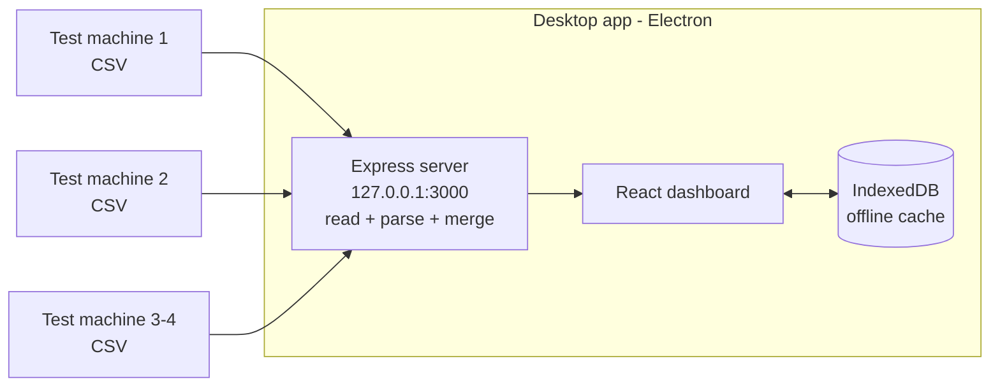

# Hourly Test Tracker

**Desktop analytics app for a factory test line.** Test machines on the shop floor each write their results to a CSV file. This app pulls those files together and shows yield, failures and retests by station and shift, so the line can see how it is doing hour by hour.

Built on request for a real production line, and used there to replace checking each machine's CSV by hand.


<details>
<summary>More screenshots</summary>


</details>

## What it does

- **Merges results from up to 4 test machines.** An engineer enters each machine's CSV location: a shared network path (`\\192.168.1.101\...`), a local file, or an HTTP URL. One click loads and combines them.
- **Shows the numbers the line cares about.** Input, Pass, Yield %, Fail and Retest, overall and per station.
- **Filters by date, time range, shift and tester.** Shifts A, B and C are worked out from each test's start time.
- **Top 5 failures.** The most frequent failure reasons, so the team knows what to fix first.
- **Pass/fail chart and a full data table.**
- **CSV export** of the filtered stats, with the filters used written at the top of the file.
- **Works offline after loading.** Data is cached on the machine, so the dashboard survives a refresh or restart without re-reading the network files.
- **Two roles.** Engineering (password) sets up the data sources. Production opens the dashboard directly.

## How it works



1. The engineer enters the CSV paths and clicks **Fetch**.
2. The local Express server reads every file in parallel, streams each one through a CSV parser, and returns one merged list of rows.
3. The dashboard tags each row with its shift, saves everything to IndexedDB, and computes the stats in the browser.
4. Every filter change recalculates the table, stats, top failures and chart from the cached rows.

### How the numbers are calculated

A device can be tested more than once, so counts are based on unique serial numbers (`DUT_SN`), not rows.

| Metric | Formula |
|---|---|
| **Input** | Unique `DUT_SN` |
| **Pass** | Unique `DUT_SN` with at least one `Pass` |
| **Yield %** | Pass ÷ Input × 100 |
| **Fail** | Input − Pass |
| **Retest** | Total rows − Input |

Shifts: **A** 06:00–14:00, **B** 14:00–22:00, **C** 22:00–06:00 (crosses midnight).

## Design decisions

| Decision | Why |
|---|---|
| **A small local server instead of reading files in the browser** | A browser cannot open a network share path like `\\192.168.1.101\...`. A Node server on the same machine can, and only listens on `127.0.0.1`, so nothing is exposed to the network. |
| **Packaged with Electron** | Line staff get a normal Windows installer. They don't need Node.js, a terminal, or a browser setup. |
| **Stream-parse each CSV, read all machines in parallel** | Files are read row by row instead of all at once, and the four machines are fetched together with `Promise.all`, so loading is as fast as the slowest machine. |
| **IndexedDB for the data, not localStorage** | A day of test results is thousands of rows. localStorage is limited to a few megabytes and stores only strings. IndexedDB holds the full dataset. |
| **Compute stats on the client** | Once the data is loaded, every filter change is instant and works with no network. |
| **Count unique serial numbers** | Retests would otherwise inflate Input and distort Yield. A unit that fails then passes on retest counts as one pass. |
| **Time range overrides shift** | If both are set, the more precise one (time range) wins, so results are never filtered twice in conflicting ways. |

## Tech stack

| Part | Tools |
|---|---|
| Dashboard | React 19, TypeScript, Vite, MUI 7 (Data Grid, Date Pickers), Recharts, date-fns |
| Local server | Node.js, Express 5, csv-parser |
| Storage | IndexedDB |
| Desktop | Electron, electron-builder (Windows installer) |

## Project structure

```
hourly-test-client/    React dashboard
  src/context/         App state, loading and saving to IndexedDB
  src/hooks/           useFilteredData: date, time, shift and tester filters
  src/components/      Login, engineering setup, production dashboard, stats, charts
  src/utils/           IndexedDB wrapper, shift and time helpers
file-fetching-server/  Express server: read, parse and merge CSVs
electron-app/          Desktop wrapper: starts the server and opens the dashboard
```

## Run locally

Requires Node.js 18+.

**1. Start the server**

```bash
cd file-fetching-server
npm install
npm start
```

It listens on `http://127.0.0.1:3000`.

**2. Start the dashboard** (second terminal)

```bash
cd hourly-test-client
npm install
npm run dev
```

Open `http://localhost:5173`.

### Expected CSV columns

```
Date, Tester_Location, Tester_Result, NG_Qty, TesterID, Carrier_SN, DUT_SN, Error_Code,
Error_Content, TesterIP, Project_Name, Script_Name, Serial_Number_Name, Tester_Duration,
Tester_Start_Time, Tester_End_Time, Record_Time
```

## Build the Windows installer

```bash
# 1. Build the dashboard
cd hourly-test-client && npm run build

# 2. Copy it into the Electron app
cd ../electron-app
rm -rf frontend && mkdir frontend
cp -r ../hourly-test-client/dist/* frontend/

# 3. Build the installer
npm install
npm run build-win
```

The installer is written to `electron-app/dist/`. The Electron app starts the server itself, so users only open one program.

## Known limits and next steps

- **The engineering password is in the client code.** Fine for a single trusted machine on the factory floor, but it should move to configuration and be checked by the server.
- **The date and time chosen on the engineering screen are not applied when fetching.** Filtering happens on the dashboard instead. The next step is to filter on the server, so less data is loaded.
- **The server code exists twice** (`file-fetching-server` and `electron-app/backend`). It should be one package, built once and copied in.
- **No automated tests.** The stats formulas and shift logic are the first targets, since the line relies on those numbers.

## Author

**Gokul Ajith V** · [LinkedIn](https://linkedin.com/in/gokulajithv) · [GitHub](https://github.com/GokulAjithV)